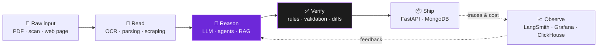

<!-- ════════════════════════════════  HEADER  ════════════════════════════════ -->
<div align="center">


<a href="https://git.io/typing-svg">
  
</a>

<br/>

<a href="https://www.linkedin.com/in/narmadha-g-794015228"></a>
<a href="https://medium.com/@narmadhaganesan1"></a>
<a href="mailto:narmadhaganesan1@gmail.com"></a>


</div>

<br/>

<!-- ════════════════════════════════  TERMINAL INTRO  ════════════════════════════════ -->
```console
narmadha@workhall:~$ whoami
Associate Software Engineer @ Workhall — building the AI layer of a no-code enterprise platform

narmadha@workhall:~$ cat ./day_job.txt
📄  Document extraction  — POs, invoices, PAN cards, MCA certificates, compliance docs
🤖  Agent Studio         — agent builder with tools, guardrails, KB/RAG & human handoff
🔀  Multi-provider LLMs  — one interface over OpenAI, Anthropic & Gemini
💸  Cost tracking        — knowing what every token costs, before finance asks

narmadha@workhall:~$ ./status --now
✔ shipping   ✔ benchmarking OCR models   ✔ writing on Medium
```

<!-- ════════════════════════════════  ASK THE MODEL  ════════════════════════════════ -->
## 🤖 &nbsp;If You Asked an LLM About Me…

```json
{
  "prompt": "Describe Narmadha in structured output. No hallucinations.",
  "response": {
    "superpower": "turning unstructured chaos into validated JSON",
    "favourite_question": "does retrieval actually make this answer better?",
    "pet_peeve": "a model that confidently invents a field that isn't in the document",
    "unpopular_opinion": "not every problem needs RAG",
    "off_screen": "on stage with a mic — hackathons, paper presentations, conferences",
    "confidence": 0.97
  },
  "usage": { "input_tokens": 42, "output_tokens": 108, "cost_usd": "tracked, obviously" }
}
```

<!-- ════════════════════════════════  HOW I THINK  ════════════════════════════════ -->
## 🧭 &nbsp;How I Build

Most AI demos stop at *"the model answered."* I care about what happens next — **is it right, is it cheap, and can someone trust it?**



<!-- ════════════════════════════════  PROJECTS  ════════════════════════════════ -->
## 🚀 &nbsp;Featured Projects

<table>
<tr>
<td width="33%" valign="top">

### 🔍 ContextIQ
**AI document comparator**

Upload two documents — PDF, DOCX, CSV, Markdown or an image — and get a summary, similarity score, categorised differences and a recommendation.

**Under the hood:** a 3-layer pipeline
1. deterministic diff (`redlines`)
2. TF-IDF semantic alignment
3. LLM interpretation

`FastAPI` `Python` `LLMs`

</td>
<td width="33%" valign="top">

### 💸 LLM Cost Tracker
**Know what every token costs**

Monitors and visualises API usage and spend across OpenAI, Anthropic and Gemini.

Backed by a pricing audit of **40+ models** — refreshed weekly, and it has already caught a 10× cached-price understatement.

`Python` `FastAPI` `MongoDB`

</td>
<td width="33%" valign="top">

### 🌐 Automating Web Intel
**AI-powered web intelligence**

A fully asynchronous service that searches, scrapes and structures web data in real time, built to scale with batch processing.

`FastAPI` `Tavily API` `AsyncIO` `MongoDB`

</td>
</tr>
</table>

<details>
<summary><b>🧪 More from the lab — click to expand</b></summary>
<br/>

| Experiment | What I did |
|---|---|
| **OCR shoot-out** | Benchmarked Baidu Unlimited-OCR vs Azure Document Intelligence vs Mistral OCR; built a reusable `UnlimitedOCRClient` |
| **PO extraction eval** | Two-step (Mistral OCR → GPT-4.1) vs single-step vision models, with field-by-field accuracy scoring and cost calculators |
| **`reasoning_effort` everywhere** | One provider-agnostic enum mapped onto each vendor's thinking controls, incl. Gemini's `thinking_budget` |
| **Agent guardrails** | A guardrail config schema: scope, blocked categories, regex rules, redact / escalate / log-only actions |
| **Multi-Agent ChatBot** | Stateful LangGraph agents with tools, memory and RAG |
| **Excel-driven tests** | pytest parametrised straight from spreadsheets via `openpyxl` |

</details>

<!-- ════════════════════════════════  TECH STACK  ════════════════════════════════ -->
## 🧰 &nbsp;Toolbox

<div align="center">


<br/>


<br/>


</div>

<!-- ════════════════════════════════  JOURNEY  ════════════════════════════════ -->
## 🛤️ &nbsp;The Journey So Far

```text
2021 ──●── B.E. Computer Science · Bannari Amman Institute of Technology
       │     🏆 BITSHACK '22 winner   🏆 Code-GitFest '22 winner
       │     🎤 Jury Choice Award — Driver Drowsiness Detection
       │     📜 Patent filed — "ODOR ALERT: Everyday Citizens' Abetment"
       │     🎙️ Hosted national conference Impellz '23 · trained 50+ students
       │
2024 ──●── ML Engineer Trainee @ Workhall
       │     first agentic workflows wired into business automation
       │
2025 ──●── Associate Software Engineer @ Workhall · graduated, CGPA 8.52
       │     extraction pipelines · FastAPI services · LangSmith tracing
       │
2026 ──●── Agent Studio · ContextIQ · LLM Cost Tracker · Web Intel
       │     ✍️ "Rethinking RAG: When Retrieval Helps and When It Hurts"
       │
  now ─◉── 🔁 still learning, still shipping — see you in the commits
```

<!-- ════════════════════════════════  WRITING  ════════════════════════════════ -->
## ✍️ &nbsp;Latest from My Medium

<!-- BLOG-POST-LIST:START -->
- [Rethinking RAG: When Retrieval Helps and When It Hurts](https://medium.com/@narmadhaganesan1)
<!-- BLOG-POST-LIST:END -->

<sub>↻ auto-updated from my Medium feed</sub>

<!-- ════════════════════════════════  STATS  ════════════════════════════════ -->
## 📊 &nbsp;On GitHub

<div align="center">


</div>

<!-- ════════════════════════════════  CONNECT  ════════════════════════════════ -->
## 🤝 &nbsp;Let's Talk

<div align="center">

**Document AI · agent design · RAG trade-offs · LLM pricing rabbit holes** — I'm always up for these conversations.

<a href="https://www.linkedin.com/in/narmadha-g-794015228"></a>
<a href="https://medium.com/@narmadhaganesan1"></a>

<sub><i>intelligent + resilient + performant — and always explainable.</i></sub>

</div>


